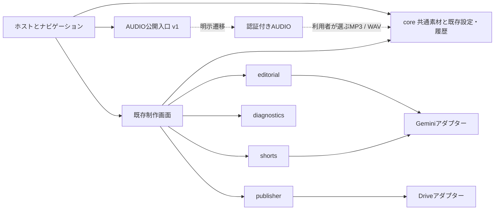

# AI STUDIO 3.0 α1 統合境界

## ADR 001 配信境界と素材の受け渡し

既存の統合設計が指定するトップレベル遷移を採用する。ホストから認証付きの別オリジンでAUDIOを開き、完成音声を利用者が選んで取り込む。AUDIOの実装・固定音源・マニフェストは別の配信元に置く。ホストは接続先をこのブラウザーの設定に持ち、起動時に接続先を取得しない。iPhoneでも同じ画面の遷移を用いる。

公開ビルドではAUDIOの入口のみ有効。統合ホストは `npm run build -- --mode private --outDir <非公開作業ディレクトリ>` で別に作る。モード指定は認証を提供しない。ホストとAUDIOの異なるHTTPSオリジンを実際に認証で保護し、HTML、JS、マニフェスト、音源の直URLも保護する。固定素材の応答は私用・保存不可のキャッシュ指定を使う。非公開ホストではサービスワーカーを登録しない。公開元と同じオリジンを再利用しない。

字幕・候補生成へ進むときは利用者が実行を選ぶ。α1では認証境界を横断した自動転送を採用しないため、AUDIOからホストへの受け渡しではファイルを一度選択する。ホスト内では共通のFileハンドルを参照し、選んだだけでデコード・送信・履歴への重複保存を開始する処理はない。

## モジュールと依存方向

- **core**は音声・動画の内部IDとリビジョン、およびローカルのFileハンドルを持つ。受け渡しのインターフェースは `ProductionAsset` と選択コールバック。Fileは同じホスト内でだけ扱う。設定、既存ジョブ、履歴の永続化は現行の実装を使う。
- **audio**の公開入口は `audioEntry` と `parseAudioEntry`。配信元の認証とv0.2.3の処理・保存はAUDIOの責務。GeminiとDriveアダプターへの依存を持たない。
- **editorial / shorts / publisher**は既存の分析、字幕・動画、Drive候補管理を維持する。物理的なファイル移動や投稿方式の追加はα1の対象外。
- **budget**は別レビューの設計に従う。α1では既存無料運用を維持し、有料処理やチャージの入口を追加しない。
- **adapters / diagnostics**は既存の接続・診断を使う。共通素材からAUDIOのWorker、OPFS、成果物名を参照しない。

## 切り戻しと受入

公開ホストは統合前の成果物を再利用できる。履歴DBの形式と公開URLを変更していない。AUDIO側はジョブの途中で実装を変更せず、切り戻し時はジョブを終了してから認証付き提供元を前の版へ戻す。既出力MP3・WAVは手元に保持できる。開発ブランチの公開成果物検査では音声・素材ディレクトリ・ソースマップ・資格情報の疑いを拒否する。

iPhone Safariの通常タブで、未認証状態から対象URLと個別ファイルの拒否、認証後に固定素材、開始と終盤試聴、ED30秒と余韻5秒、WASM MP3・WAV、取消後の再試行を確認する。出力はファイルアプリで再生し、認証付きホストから明示的に取り込む。15・30・60・90分は同一素材を単体版とα1から開いた版で使い、端末・iOS・空き容量・所要時間・ファイル容量・失敗工程を記録する。

[WebKit ストレージ方針](https://webkit.org/blog/14403/updates-to-storage-policy/) · [Apple Safariリリースノート](https://developer.apple.com/documentation/safari-release-notes/safari-26-release-notes) · [Chromium File System Access](https://developer.chrome.com/docs/capabilities/web-apis/file-system-access) · [Mediabunny MP3拡張](https://mediabunny.dev/guide/extensions/mp3-encoder)
