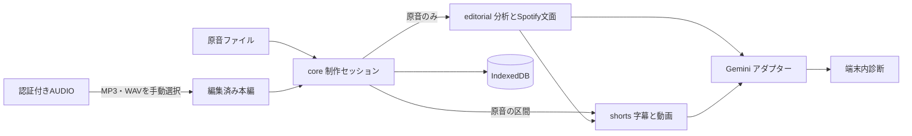

# AI STUDIO 3.0 α2 制作セッション

基準は α1 の `dc708d42b8f273036b7602ce02376c04f1956405`。開発ブランチは `development/ai-studio-v3.0-alpha2`。PRは差分を分けてレビューできるよう α1 をベースにする。

## 責務とデータの流れ

| 境界 | 責務・公開インターフェース |
|---|---|
| core | `ProductionSession` と素材の役割、`selectOriginal`、端末内保存・復帰。エピソードIDと原音リビジョンをチェックポイントに結び付ける。 |
| audio | α1の認証付きAUDIOを別画面で開く。非公開モードでは利用者が選んだMP3/WAVを編集済み本編として受け取る。 |
| editorial | `EpisodeAnalysis`、候補・番組の事実の抽出、Spotify用文面生成。初回に抽出した事実だけで文面を作れる場合は音声を再処理しない。 |
| shorts | `sourceClipRange`、範囲キー、字幕・話者・書き出し済み動画のチェックポイント。既存の字幕補正と720p/1080p書き出しを利用する。 |
| Gemini adapter | 通信の用途、モデル、応答時刻、試行番号、HTTP結果、返却された利用量、端末内キャッシュ利用のみを診断に渡す。 |

原音のファイルはチェックポイント本体と分ける。履歴作成時に同じIDの履歴へ移動し、一つのIndexedDBトランザクションで元の一時素材を外す。候補の時間は原音先頭基準、字幕の時刻は候補先頭基準のミリ秒。編集済み本編の時間軸を字幕に適用するには編集点情報が必要になる。名前・範囲・動画を復帰しても元の話者IDと区間を変えない。履歴からの既存制作経路とGoogle Drive出力は従来どおり利用できる。

復帰UIは最後に開いた制作セッションを対象とする。端末にコミットした素材とチェックポイントを復帰でき、処理中のGemini要求やエンコードは再開ボタンを押してやり直す。原音が端末からなくなった場合は別の素材として扱う。書き出した動画や字幕の保存容量はブラウザーのサイトデータ上限に左右される。チェックポイントは既存の履歴バックアップの対象外。

## ADR 002 — AUDIOの画面間ファイル受け渡し

α1の別オリジン認証境界とファイル選択を維持した。ブラウザーの同一オリジン制約上、AUDIOのIndexedDBを直接引き継げない。画面間メッセージでのBlob転送は、互いのオリジンと認証の検証、画面寿命、モバイルのメモリと中断への対策を別途必要とする。今回は利用者が非公開モードで完成ファイルを選び、公開バンドルに固定音源を含めない。連携のためのサーバーや外部ストレージは追加していない。

資料: [MDN 同一オリジンポリシー](https://developer.mozilla.org/en-US/docs/Web/Security/Same-origin_policy) · [MDN Window.postMessage](https://developer.mozilla.org/en-US/docs/Web/API/Window/postMessage) · [WebKit ストレージポリシー](https://webkit.org/blog/14403/updates-to-storage-policy/)

## 実機確認手順

1. α1の手順と同じく、認証で保護されたHTTPSの統合ホストとAUDIOを別のオリジンに用意する。未認証の端末からHTML、JS、マニフェスト、音源の直URLが保護されていることを確認する。公開端末では合成試験素材を使う。
2. iPhoneのSafariで原音を選択する。候補が出たら字幕を作り、話者名を設定し、ショートを1本書き出す。Spotify用文面と履歴を確認する。
3. AUDIOで編集済み本編を作り、出力したMP3/WAVを非公開ホストの音声タブで取り込む。原音が同じまま表示されることを確認する。
4. ページを再読み込みし「保存した制作を再開する」を押す。候補、話者、字幕、動画が復帰することを確認する。設定の「処理時間の診断」から記録をコピーできる。
5. 字幕の発話始点と終点を試聴し、Google Drive保存と端末共有を確認する。通信失敗やバックグラウンドから復帰した際は、完了済み項目を使って失敗工程を再試行する。
