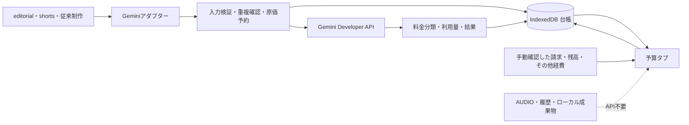

# AI STUDIO 3.0 α3 予算・API利用管理

基準コミットは α2.1 の `123a83ce9cec195366a0de22a0987181d027b804`。開発ブランチは `development/ai-studio-v3.0-alpha3`。PRはα2のブランチへの積み上げとして扱う。

## 動き

- 同じブラウザーの同一オリジンとプロファイルでは、予約の検査と確保を一つのIndexedDB書き込みトランザクションで行う。異なるタブから同時にリクエストしても残予算を取り合う。送信直前に上限を判定する。1,600円以上で警告し、税込・為替余裕込みの計算で2,000円を超える見込みの有料要求を止める。
- 有料の標準生成は確認済みモデルだけ対応。基本料金と入出力上限を使って、最大入力・応答・推論分を予約する。保守的なため残予算が小さいと、短い生成でも停止することがある。有料時の検索グラウンディングは外し、過去回からの提案は継続する。確認できない追加ツールやモデル、未知の料金は予約エラーにする。処理の検証、構造化字幕、ローカル修復、履歴・キャッシュの再利用は既存機能を継承する。
- 有料生成は一操作4送信まで。再試行も各回で予約し、上限が足りなければ止める。処理中の同一モデル・同一リクエスト本体はSHA-256で照合する。本文・キー・音声・出力は保管しない。ハッシュは処理中の重複判定にのみ使い、応答確定または手動照合で外す。ブラウザーを閉じた場合でも保護額を自動で手放さない。
- 終了理由に応じてGoogleの非ストリーミング課金規則を適用する。確定したHTTP 4xx/5xxや入力ブロックは非課金、`SAFETY` は入力分のみ。通信切断、応答の解析不能、請求に必要な利用量の欠落は最大予約を未確定として保持する。成功応答の構造化データをアプリで採用できなかったときは、採用失敗として費用を残す。
- 月・日の集計は日本時間。既知の推定円額と手動登録した実請求・確認額を表示する。制御には「全推定額」と「確認額＋確認時刻後の推定額」の大きい方に、その他経費、処理中予約、照合前の未確定額を加えて使う。確認済みの累計額と照合した未確定分は保護額から外す。処理中のまま中断した予約は10分以上経過し、Google側でその時刻までの累計を照合した場合にのみ同様に整理できる。
- 料金・換算条件は要求ごとのスナップショット。税・為替余裕は予算制御用の仮定。通貨・確認日・出典・改定適用日を価格表に持つ。キャッシュ入力は公式割引率で計算し、音声の内訳がない要求には割高になる側の仮定を用いる。推論は出力と同じ単価。
- 台帳はこのブラウザーに保存する。クラウドへの同期や履歴のバックアップへの包含は行わない。サイトデータを消すと消える。長期大量の要求によるストレージとトランザクションの負荷は未計測。

## 前払い・後払いとGoogle側の管理

1. Google AI Studioで対象プロジェクトが無料か有料か確認し、アプリの「予算」タブで同じ方式を選ぶ。アプリは既定で無料。APIキーだけで課金方式や他利用分を照合する機能は組み込んでいない。有料キーを無料として設定した場合はアプリの有料ブロックが適用されない。
2. 前払いではAI Studioが表示する残高の円換算値を手動で登録する。残高・確認日時と月間消費は別々に表示する。確認後の推定と予約を差し引いた残高が500円以上なら通常、300〜499円は予定確認、300円未満はチャージ検討。制作予定額が残高を超える場合は不足目安を示す。公式の前払い最低購入額はUSD 5と案内されており、実際の額はAI Studioで確認する。チャージ残高は前払いの資産残高なので月間API消費に二重計上しない。後払いは確認した請求累計と残予算で判断する。自動チャージは実装していない。
3. 前払いクレジット残高はAI Studio Billingで確認する。公式Gemini Developer APIに残高を返す操作は確認できなかった。Cloud Billingで請求・アカウント情報を扱うには別の認証と権限が必要。α3は認証権限を増やさず手動照合する。
4. 本運用を承認した場合は、Gemini API専用のGoogleプロジェクトに分け、Google AI Studioのプロジェクト月間spend capとCloud Billing予算アラートを併用する。公式のプロジェクトspend capは試験機能で約10分の反映遅延による超過があり得る。Cloud Billing予算は通知用。別端末・オリジン・プロファイル・他クライアント・手動入力の誤り・Google側集計の遅れをこのアプリからは止められない。アプリのJST月次とGoogleの明細期間は照合時に確認する。

## 公式資料と料金表

確認日 2026-11-28。標準非ストリーミング生成のUSD／100万トークン。2027-01-01の適用日からGemini 3.8 Flash、3.6 Flashを入力1.50／出力7.50へ変更する。日付境界は予算制御上JSTで保守的に適用。

| モデル | テキスト入力 | 音声入力 | 出力・推論 |
|---|---:|---:|---:|
| Gemini 3.8 Flash / 3.6 Flash | 0.75 | 0.75 | 3.75 |
| Gemini 3.5 Flash-Lite | 0.30 | 0.30 | 2.50 |
| Gemini 3.1 Flash-Lite | 0.25 | 0.50 | 1.50 |
| Gemini 2.5 Flash | 0.30 | 1.00 | 2.50 |
| Gemini 2.5 Flash-Lite | 0.10 | 0.30 | 0.40 |

上記は公式表に記載された対応モデルの抜粋。古いモデルの提供・置換・アカウント別の利用可否を実APIで確認していない。

- [Gemini API 料金](https://ai.google.dev/gemini-api/docs/pricing) · [モデル一覧と入出力制限](https://ai.google.dev/gemini-api/docs/models) · [応答のUsageMetadata](https://ai.google.dev/api/generate-content#UsageMetadata)
- [前払い・後払い・非課金条件・spend cap](https://ai.google.dev/gemini-api/docs/billing) · [Files API](https://ai.google.dev/gemini-api/docs/files) · [Cloud Billingの予算アラート](https://docs.cloud.google.com/billing/docs/how-to/budgets)

## 模擬試験

`npm test`、`npm run build`、`node scripts/check-public-build.mjs`、`npm run e2e`。予算の2タブ試験は `npm run dev -- --host localhost --port 4257 --strictPort` を起動し、`node e2e/budget.js` を実行する。テストのGemini要求はPlaywrightが捕捉する。
