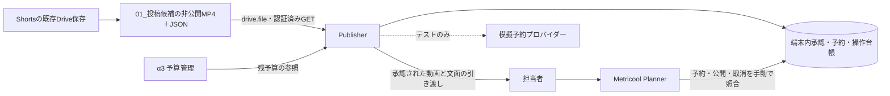

# AI STUDIO 3.0 β1 投稿管理

基準は α3 の `7fcb254d44689e2ddc5b9ebd02c792990bf1f433`。α3のドラフトPR #58をベースとする。調査確認日 2026-11-28。

## 接続環境と調査

Metricoolの読み取りコネクタでブランド `7399385`、タイムゾーン `Asia/Tokyo`、Instagram `bridge_radio`、TikTok `bridgeradio2000`、YouTube `UCTY_9yQowUpcUEPdh574WaA` を確認した。2026-11-28〜12-31の予約済み一覧は0件。これは予約の照会結果で、公開済み履歴・月間枠の使用数やアカウント権限の検証には使えない。各SNSの推奨時間を11月29日〜12月4日で読み取った。分散提案には日別スコアを合計した上位時間帯（Instagram 10時、TikTok 10時、YouTube 16時）を使う。同時案は共通候補の10時を使う。取得対象の期間外は翌日19時等の仮時刻を明示する。実績から成果を予測する処理は持たない。

| 経路 | 費用・条件 | セキュリティ・保守 |
|---|---|---|
| FreeのPlannerに承認済みMP4を手動添付 | 1ブランド、月20件。同一投稿の複数ネットワークはβ1で個別管理し、月枠は手元で保守的に試算。追加固定費0円 | 既存Driveの非公開権限と既存Plannerを利用。利用者がファイルと文面を選び、実予約・照合・取消を担当 |
| ChatGPTのMetricool MCP | Metricool Freeも対象で月20件、クライアント側の利用条件も適用。承認レビュー機能はチーム管理プランが必要 | 読み取りを実確認。APIで送信された動画の確認は未実施。URL取得に認証を要するDriveの共有URLを渡さない。添付経路の可否は環境別に確認 |
| StarterのPlanner Drive連携 | 公式英語ページの表示は年払いの月換算USD 20〜、月払いUSD 25〜。表示通貨・地域により異なる | PlannerでGoogleに接続し、権限範囲の動画を選ぶ。人間の確認と投稿操作が必要 |
| Advanced/CustomのMetricool API | Advancedの表示は年払いの月換算USD 53〜、月払いUSD 67〜。1 USD=150円の比較例で約7,950〜10,050円/月、税等は別。Starterも同換算で約3,000〜3,750円/月 | 認証付き中継にAPIトークンを保管する。さらに非公開バイナリの正式なアップロード経路、実予約照合、外部ID、取消と遅延時の状態回復を契約前に検証する |
| 各SNS公式API | 少量なら公開APIのクォータ内運用を検討できる。審査や中継、保守工数は別。無償サーバー枠の継続利用は未評価 | 3種類のOAuth権限、審査、アップロード・状態管理を実装する。β1の静的アプリだけでは端末を閉じた後の予約時刻の処理は持続しない |

[Metricool公式プラン](https://metricool.com/pricing/) · [MCPのプランと制限](https://help.metricool.com/en/article/mcp-limits-and-plan-requirements-h72jg/) · [Google Drive連携](https://help.metricool.com/en/article/google-drive-integration-0u1ei/) · [スマホでDriveからコピーを送る](https://help.metricool.com/en/article/how-to-share-files-from-google-drive-to-metricool-from-your-mobile-1oxn3/) · [Metricoolのメディア要件](https://help.metricool.com/en/article/publishing-requirements-for-images-and-videos-from-metricool-vfc8n/)

- **Instagram Reels**。プロアカウントが対象。Instagram Loginの代表権限は `instagram_business_basic` と `instagram_business_content_publish`。媒体をコンテナにアップロードし、処理完了後に公開する。標準URL経路ではMeta側から取得可能なURLが必要。公式の再開可能アップロード経路もある。従来の1080×1920・H.264/AAC MP4を共通プリセットとし、Plannerのプレビューで映像・音声を確認する。[Meta コンテンツ公開](https://developers.facebook.com/docs/instagram-platform/instagram-api-with-instagram-login/content-publishing/)
- **TikTok**。Direct Postは `video.publish` の許可とユーザー同意が必要。クリエーター情報から許可された公開範囲、動画上限等を取得し、本人の選択を尊重する。FILE_UPLOADはバイナリ転送、PULL_FROM_URLはドメイン／URLプレフィックスの所有確認が必要。未監査は `SELF_ONLY`。審査ガイドには自社・チーム管理アカウントへの専用アップロードツール等を対象外とする例があり、この用途の採用可否を事前に判断する。公開結果はステータス取得APIで照合する。[TikTok 開始手順](https://developers.tiktok.com/doc/content-posting-api-get-started/) · [審査ガイド](https://developers.tiktok.com/doc/content-sharing-guidelines/)
- **YouTube Shorts**。OAuthと `videos.insert` の再開可能アップロード、`videos.list` の状態照会を利用できる。未監査プロジェクトには非公開制限がある。予約は未公開の非公開動画に `status.publishAt` を設定する。縦型・正方形は3分までShorts対象。タイトルと子ども向け設定を確認する。[YouTube videos.insert](https://developers.google.com/youtube/v3/docs/videos/insert) · [YouTube videos リソース](https://developers.google.com/youtube/v3/docs/videos) · [3分までのShorts](https://support.google.com/youtube/answer/15424877)

## 構成と実装

- 既存の `drive.file` スコープとメモリ内トークンを利用。候補一覧は対象フォルダのアプリ管理ファイルのみ。JSONと動画の候補ID・版ID・ファイルID・親フォルダを揃えて読み、プレビュー・承認・引き渡し時に動画ハッシュと投稿情報を再照合する。動画は一時的なBlob URLでプレビューする。Driveの権限変更、コピー、移動、SNS送信は行わない。既存の承認済み／投稿済みフォルダを新設・再構成していない。
- 投稿文、タイトル、タグを既存のDrive JSONから引き継ぐ。Geminiを呼び出さない。SNSごとに編集し、日本時間の同時／分散案を適用できる。ユーザーによる承認は動画版・投稿先・文面・日時・YouTube視聴者設定に紐づく。編集すると再承認が必要。
- 承認後の引き渡しはローカル予約枠を先に確保する。同一候補または同一動画ハッシュと投稿先の組み合わせは、同じオリジン・ブラウザープロファイル内のIndexedDB書き込みトランザクションで抑止する。成功・取消・失敗・結果不明の履歴を保持する。結果不明からは外部を照合して記録するまで再試行を止める。外部IDは同じSNS内で重複登録できない。手動判定の裏付けは担当者の照合に依存し、別ブラウザーや手動予約をアプリから検出できない。
- 無料枠はJSTの予約月ごとに現在の台帳と手動登録された台帳外枠を合算する目安。Metricoolの時刻・計数・取消後の枠扱いはPlannerで確認する。β1は無料の手動経路だけを表示し、見込み費用を発生させるプラン変更や中継は提供しない。α3の月間残予算を参照できる。

## 実サービス受入

1. 個別承認の前は読み取りだけ行う。Driveの既存候補を非公開のまま取得できるか、iPhoneでMP4をプレビューできるか、Metricoolの対象アカウントと手動添付を確認する。
2. 経営本部が動画の版・文面・SNS・日時を個別承認した後、候補を承認済みにして引き渡す。PlannerでMP4を端末から添付し、各SNSの公開条件と残枠を確認してから操作する。公開URLを作る操作は不要。
3. Plannerの予約IDを記録する。応答が不明ならPlannerの予定と各SNSアカウントで照合する。確認が取れるまで新規作成しない。取消時はPlanner側で取消を確認してから台帳に記録する。公開後は投稿先の外部IDを記録する。
4. 自動化へ進む場合は、プランの費用承認、非公開転送の公式な対応、認証付き中継・秘密管理、複数端末の冪等性、サンドボックスでの取消・状態照合を先に検証する。

模擬テストは `npm test`、`npm run build`、`npm run e2e -- publisher`。3 SNSの予約・照合・取消アダプターは `npm run dev -- --host localhost --port 4265` を起動し `node e2e/publisher-dispatch.js` を実行する。
