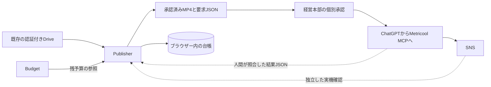

# β1.2 配信結果と実機確認

## 実証の扱い

2026-11-28の運営報告を設計とテストに反映した。YouTubeの `PUBLISHED` はAPI配信成功として記録する。試験時の指定は `private`、登録者通知なし。YouTube側の実際の公開範囲と再生品質は未確認。TikTokの `AWAITING_CONFIRMATION` は詳細が `Published` でも配信確認待ち。iPhoneの非公開一覧で存在を確認した事実を独立した実機確認として記録する。Instagramは `draft:true, autoPublish:false` の下書きで、公開・実配信の実証対象外。

動作試験は上記の状態を合成IDで再現した。実動画や試験アカウントの完全なAPIレスポンスを試験データや公開Gitに入れていない。今回の開発に実SNS操作は含まれない。実証経路はChatGPT → Metricool MCP → SNS。AI STUDIOは承認、照合、引き渡し、履歴管理を担当する。直接配信とDriveからの完全自動転送は未接続。

## 依存と状態



投稿候補・承認待ち・承認済みから、予約処理中、予約済み、下書き登録済み、配信処理中、配信確認待ち、API配信成功、配信失敗、結果不明、取消へ進む。実機確認済みは独立した観測で、API状態を書き換えない。結果不明の時は新規送信を行わず、既存IDを照合する。ユーザーの手動記録とβ1.1の結果JSONを維持する。新しいAPI結果がある行の再照合はv2で受け付ける。

古い観測と状態の巻き戻しは拒否し、同一結果の再取込は無変更。既存投稿ID、UUID、媒体動画ID、配信応答IDを別々に保持し、同一媒体の同一外部投稿を別の要求に登録できない。投稿IDが変更された場合は同じUUIDが確認できるときだけ既存行を更新する。実機確認は確認者、日本時間で入力した日時、確認内容を保存する。実機確認後の矛盾する取消・失敗は照合を求める。

Firestoreや外部コールバックによる自動照合は行わない。取り込むAPI原文は照合者が認証情報や一時URLを除いて入力する。原文と正規化状態を分け、画面では原文をテキストとして表示する。台帳は同一オリジン・ブラウザーのIndexedDBに保存する。

## 要求・結果 v2

要求 `bridge-radio.publisher.request.v2` は既存の照合キーに加え、承認された公開範囲、登録者通知、下書きと自動公開の有無を持つ。設定を変えたら再承認が必要。公開設定はInstagramの下書き・一般公開予定、TikTokのSELF_ONLY・一般公開予定、YouTubeのprivate・一般公開予定を表す。実行には別途承認が必要。

結果 `bridge-radio.publisher.receipt.v2` の例。合成値。日時は予約要求と同じJST時刻。照合日時はUTC。結果を入力する前に外部の投稿IDを確認する。

```json
{
  "schema": "bridge-radio.publisher.receipt.v2",
  "brandId": "7399385",
  "requestId": "<予約要求のID>",
  "videoVersion": "<動画版>",
  "sha256": "<動画ハッシュ>",
  "approval": "<予約要求の承認版SHA-256>",
  "destination": "tiktok",
  "observedAt": "2026-11-29T13:22:00.000Z",
  "provider": {
    "postId": "mock-post",
    "uuid": "mock-uuid",
    "responseId": "mock-response",
    "apiState": "AWAITING_CONFIRMATION",
    "detail": "Published",
    "scheduledAt": "2026-11-29T22:00:00+09:00",
    "visibility": "SELF_ONLY",
    "raw": "{\"status\":\"AWAITING_CONFIRMATION\",\"detail\":\"Published\"}"
  }
}
```

`videoId` は媒体の動画ID、`responseId` は配信応答のID。片方を他方の代わりに使わない。YouTubeの `notifySubscribers`、Instagramの `draft` と `autoPublish` は得られた場合に残す。承認済みの動画ハッシュと投稿要求IDが分からない過去の試験結果は自動登録しない。対象の履歴行と照合したうえで、受入時に管理者が取り込む。

## 無料枠と運用

MetricoolはFreeを月20投稿までと案内している。サービス側の当月の実消費は今回取得していない。画面は担当者が確認した値と、その日時、上限判定用の推定を分ける。推定ではSNS別に数え、下書きと処理中・結果不明も保守的に保持する。確認値以後の処理も加えて上限を守る。取消・下書き・一括へのサービス側の細かな計数はPlannerで照合する。総予算は既存の2,000円。投稿管理にGemini通信、動画の新規エンコード、SNSへの追加送信を行う経路は追加していない。 [Metricool公式料金](https://metricool.com/pricing/) · [MCPの条件](https://help.metricool.com/en/article/mcp-limits-and-plan-requirements-h72jg/)
