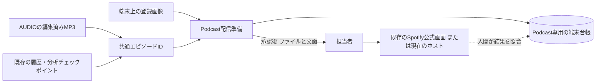

# AI STUDIO 3.0 β2 Spotify本編配信準備

調査確認日 2026-11-28。基準はβ1.2のドラフトPR #60、`bc9dcfe1a914dc1ac0d43109debd83020bdd13bc`。

## 方式比較

| 方式 | 可否・認証 | 費用・保守・既存番組への影響 |
|---|---|---|
| Spotify公開Web API | Episodesの参照は公式資料で確認。Spotify for Creatorsの本編音声アップロード、作成、配信予約の公開APIは公式リファレンスで確認できなかった | 書き込み用アダプターを接続しない。非公開エンドポイントやCookieの転用を行わない |
| Spotify for Creatorsの公式Web／iOS | Spotifyがホストする既存番組で担当者がログインしてMP3を選択し、文面、コンテンツ確認、番号、予定日時を登録。エピソード画像の更新は公式Web | **採用**。追加固定費0円。番組、RSS、フォロワー、履歴を移行する工程がない。権限とアカウント確認はSpotify側で行う |
| iPhoneショートカット | 共有シートを入力にでき、Filesへ保存、文面の整理、公式画面を開く補助が可能。Spotifyへの書き込みは公式に確認できなかった | 追加固定費0円。共有先や受理可能な型は端末依存。β2は標準のWeb Shareと個別保存を提供し、ショートカットの配布は行わない |
| ブラウザー半自動化 | 自アプリで素材・コピーを用意し、担当者が公式画面へ遷移。認証の引継ぎ、DOM操作、クロール、バックグラウンド投稿は採用しない | UI変更の影響を受ける箇所は公式画面への入口に限る。Creator Terms、開発者規約、ユーザーガイドラインを確認し、許可が確認できない自動アクセスを避ける |
| RSS／現在の外部ホスト | 外部ホストなら担当者は既存ホストへ登録し、Spotifyへは既存RSSから配信。SpotifyホストのRSSは既存の配信用フィード | 現行構成を維持する。自己ホストやホスト変更は永続的なフィード、公開enclosure、監視、301リダイレクト等が必要。移行確認なしに変更すると既存リスナーと配信履歴に影響し得る |
| 新規外部ホスティング | 例としてTransistorの公式APIはキー認証でアップロード、エピソード作成、予約が可能。Buzzsproutの無料枠は月2時間、エピソードの保持90日 | Transistor Starter月払いUSD 19（1 USD=150円の比較例で約2,850円、税等別）。Buzzsprout無料枠の保持期間は継続的な既存アーカイブの代替にしない。どちらも新規契約・移行・キー預かりは行わない |

対象番組のホスト、管理権限とログイン状態は実アカウントで検証していない。Spotifyホストを利用していない場合は、同じローカル素材を現在のホストに引き渡す。Spotifyの公式画面に番組を新規作成する手順は含まない。

- [Spotify Web API](https://developer.spotify.com/documentation/web-api/reference/) · [エピソード参照](https://developer.spotify.com/documentation/web-api/reference/get-an-episode) · [音声エピソードの公式公開手順](https://support.spotify.com/creators/article/publishing-audio-episodes/) · [エピソード画像](https://support.spotify.com/creators/article/uploading-cover-art/)
- [Spotify for Creators利用規約](https://www.spotify.com/us/legal/spotify-for-creators-terms/) · [開発者規約](https://developer.spotify.com/terms) · [ユーザーガイドライン](https://www.spotify.com/to/legal/user-guidelines/)
- [Appleの共有アクション](https://support.apple.com/en-asia/guide/shortcuts/apdaf74d75a5/ios) · [SpotifyのRSS](https://support.spotify.com/creators/article/finding-and-enabling-your-rss-feed/) · [301リダイレクトの手順](https://support.spotify.com/creators/article/switching-away-from-spotify-for-creators-with-a-301-redirect/)
- [Transistorの料金](https://transistor.fm/pricing/) · [Transistor公式API](https://developers.transistor.fm/) · [Buzzsprout Free](https://www.buzzsprout.com/help/231-what-is-included-in-the-free-plan)

## 実装と安全境界

Podcast画面をSNSから分離し、遅延読み込みする。AUDIOは既存の認証付き統合環境のMP3取込を使う。Podcast台帳はエピソードID、文面、番号、予定日時、確認済みカバー、編集済み音源IDとSHA-256、承認、照合結果を保持する。MP3は既存の素材保管に置いたまま使う。カバーは承認時の版を保つため台帳に保存する。原音を代用せず、Geminiによる文面や画像の再生成、MP3変換、Spotifyへの自動送信を行わない。

担当者が保存、チェック、承認した版だけを引き渡せる。ファイル差し替え、文面・カバー・日時変更で再承認を求める。引き渡しの予約はIndexedDB内で原子的に記録し、同一ブラウザー内の同じ回、番号、音源の二重引き渡しを防ぐ。結果不明、下書き、予約は台帳で保持し、再投稿せず同じSpotify側の記録を照合する。存在しないことを確認できた場合に限り再承認に戻る。共有したファイルの遠隔撤回と端末横断のロックは行えない。

## 人間の操作と受入

編集済みMP3と既存の文面・画像が揃った状態から、音声タブ、MP3選択、本編配信タブ、回番号、日時、画像再利用、保存、承認者、チェック、承認、引き渡しを順に試験する。確定後はタイトルと説明文をコピーし、MP3・カバーを保存または共有する。Spotifyで既存番組を選び、内容・画像・タイムゾーンを確認して、個別承認を得た担当者が予約を確定する。Spotifyの手動操作数と待機時間は実運用で測る。結果が分からない際は新規作成を再開しない。

ローカル検証は `npm test`、`npm run build`、`node scripts/check-public-build.mjs`、`npm run e2e`。Podcastの素材再利用・承認・復帰は `npm run dev -- --mode private --host localhost --port 4276` と `node e2e/podcast.js` で合成素材の試験を行う。本番と異なるローカル非公開モードを使い、Spotifyへのアクセスを含む外部リクエストを監視する。
