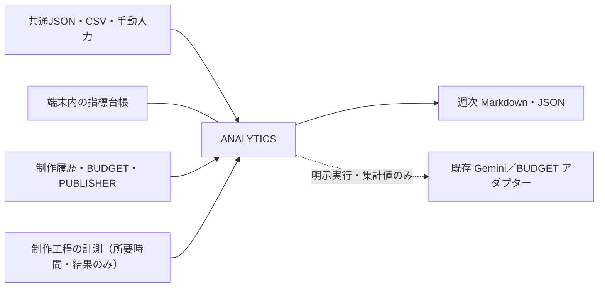

# AI STUDIO 3.0 β3 分析運用

経営ダッシュボードの通常操作は端末内で完結する。経営会議に渡すときは「経営分析 → 週次経営会議向け報告」でMarkdownをコピーするか、MarkdownまたはJSONを保存する。

## 取得経路と検証範囲

一次資料確認日 2026-11-28。

| 対象 | 取得経路・確認結果 | β3の対象外・未確認 |
| --- | --- | --- |
| Spotify | Spotify for CreatorsのWeb版が提供する指標ごとのCSV。番組・エピソードの集計を共通CSVへ整形、または「手動で指標を登録」から入力する | 実アカウントのCSVと画面操作は未試験。Spotify Web APIのエピソード情報にはクリエイター向け指標の取得経路を確認できなかった |
| Instagram | Metricool MCPのevolution・posts・reels指標の定義を取得。アカウントのviews・followersを実ブランドで読み取りのみ確認 | 投稿単位の指標は定義のみ確認。接続権限による取得範囲の差と無料アカウント固有の制限は未試験 |
| TikTok | Metricool MCPのevolution・posts指標の定義を取得。アカウントのviews・followersを実ブランドで読み取りのみ確認 | 動画別実数・無料枠の範囲は未試験 |
| YouTube | Metricool MCPのevolution・videos published in range指標の定義を取得。アカウントのvideoViews・subscribersを実ブランドで読み取りのみ確認 | 動画別実数・登録者純増の実データ・無料枠の範囲は未試験 |
| 制作・配信と費用 | この端末の制作履歴、PUBLISHER、BUDGETを参照。短尺書き出し・AI送信前変換・本編引き渡し処理の経過時間は、β3以降の処理から記録 | 別オリジンのAUDIOの作業時間と編集者の操作時間は手動入力。履歴に未記録の配信や他端末の費用は取得対象外 |

Metricoolの実読み取りは2026年11月21〜27日を指定した。6指標の応答形式に日付、数値文字列、nullが含まれることまで確認。値はアプリへ保存していない。公開案内上、Freeの分析対象期間は直近30日。契約・権限・媒体仕様で取得範囲が変わる。追加のプラン変更は不要。

- Metricoolのデータ取得、MCPクライアントとプランの案内。[Metricool MCP FAQ](https://help.metricool.com/faqs-about-the-metricool-mcp-1i3w0)
- SpotifyのWeb版の指標CSV、エピソード分析、再生の定義。[CSVエクスポート](https://support.spotify.com/ws/creators/article/downloading-your-shows-analytics-data/) · [エピソード分析](https://support.spotify.com/cg-en/creators/article/episode-analytics/) · [概要指標](https://support.spotify.com/au/creators/article/overview-analytics/) · [Spotify Web API Get Episode](https://developer.spotify.com/documentation/web-api/reference/get-an-episode)

## 共通データ形式

ファイルの上限は1 MB、1回の上限は5,000件。日付はJSTの対象期間（両端を含む）で、取得日時と投稿日時はUTCのISO 8601。認証情報、ユーザー情報、視聴者の個票や自由記述を含めず、集計値と投稿・エピソードのIDだけを渡す。

ChatGPTから取り込む場合はMetricoolの指標定義、レスポンスの列と項目の対応、取得日時を確認してから共通形式へ変換する。レスポンスが無記名列の行配列で、列の対応を確認できないときは登録を保留する。SpotifyのCSVは画面で選んだ指標名と期間を保って共通形式の列に整形する。独自形式のCSVを直接解釈する処理はこの版の対象外。

```json
{
  "schema": "bridge-radio.analytics.v1",
  "rows": [
    {
      "platform": "instagram",
      "source": "metricool",
      "quality": "measured",
      "metric": "plays",
      "definition": "IGEV05",
      "start": "2026-11-21",
      "end": "2026-11-21",
      "acquiredAt": "2026-11-28T03:00:00Z",
      "unit": "count",
      "value": 123
    }
  ]
}
```

```csv
platform,source,quality,metric,definition,start,end,acquiredAt,unit,value
spotify,spotify-creators,measured,plays,spotify-plays,2026-11-21,2026-11-21,2026-11-28T03:00:00Z,count,12
tiktok,metricool,missing,plays,TKEV02,2026-11-21,2026-11-21,2026-11-28T03:00:00Z,count,
```

| 対象 | 代表的な対応 |
| --- | --- |
| Instagram | アカウント `IGEV05` views、`IGEV01` followers。Reels `IGRE23` views、`IGRE10` likes、`IGRE07` comments、`IGRE21` shares |
| TikTok | アカウント `TKEV02` views、`TKEV07` followers。動画 `TKPO07` views、`TKPO08` likes、`TKPO09` comments、`TKPO10` shares |
| YouTube | アカウント `YTEV02` videoViews、`YTEV01` subscribers。動画 `YTVP06` views、`YTVP09` likes、`YTVP11` comments、`YTVP12` shares。純増を登録する場合は同期間の `YTEV05` − `YTEV06` を `YTEV05_minus_YTEV06` として記録 |
| Spotify | `spotify-plays`、`spotify-followers` など。Spotify画面の再生数とRSSのダウンロードを同じ指標に入れない |
| 手動 | 指標名の先頭に `manual-`。たとえば `humanMinutes` は `manual-humanMinutes`、単位 `min` |

- 欠損は `quality: "missing"` と `value: null`。CSVでは数値欄を空欄にする。実測0は数値の0を入力する。
- アカウント集計の `entity` は省略する。投稿・エピソード単位では既存の候補ID、実際の外部投稿・動画ID、またはエピソードIDを指定する。媒体を含めて照合する。
- 公開以来の累積値は `basis: "lifetime"`、`entity` を必須とし、`start` と `end` は同じ観測日にする。期間集計や投稿時間帯比較の対象は期間内指標のみ。`topic` と `postedAt` は任意。
- 再取込の同一性は媒体・取得元・定義・ID・集計基準・期間で判定する。同じ取得時刻の内容に食い違いがあれば取り込み全体を中止し、取得時刻が新しい値を採用する。
- 今週・今月の比較は昨日まで。月の長さが異なる場合、双方を同日数とする。期間と完全一致する集計値を優先し、日別値を足す場合は対象日すべてが揃うことを要件とする。フォロワー・登録者数は期間末の値を表示する。初日は確定日なし。
- ショートの投稿時刻別実績は同一媒体・定義内の観察値。6時間帯ごとに2件以上かつ2区分以上が必要。公開後の経過時間・曜日・企画などを統制した効果測定は対象外。
- 月間予算はBUDGETの照合済み請求・推定・予約額などを参照。エピソード費用は紐づけられたGeminiの既知推定の小計。人件費や共通経費の割当は対象外。
- Markdownの公開範囲は運用担当が確認する。週次JSONはエピソードID・投稿IDを含む。同期は端末外へ自動送信しない。

## 構成



iPhone受入時は認証済みの非公開試験環境で「経営分析」を開き、集計済みCSVを投入する。同じファイルを再投入して登録0件、再起動後も値を参照できること、FilesへのMarkdown・JSON保存と経営会議画面へのテキスト貼り付けを確認する。最初はGemini追加分析を起動せずに確認する。
